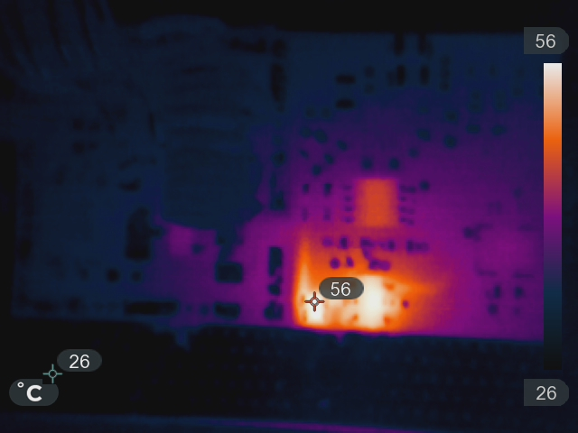
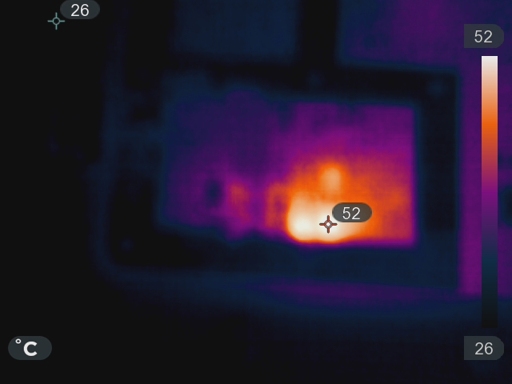
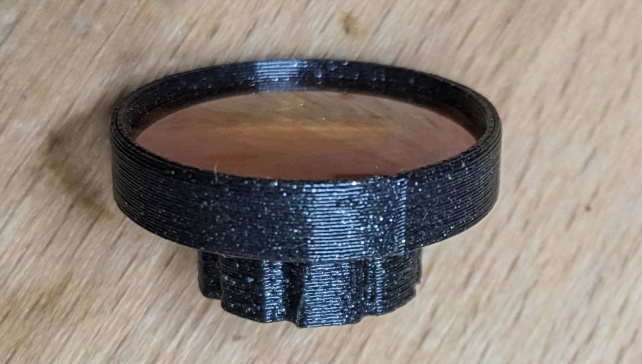
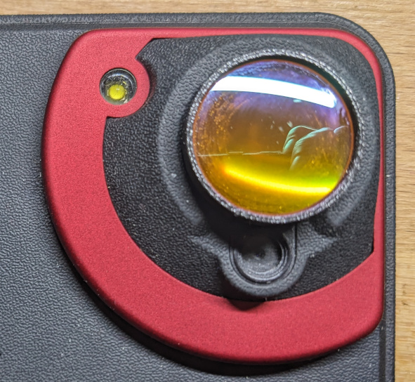

Seek shot pro macro lens
========================

The seek shot pro thermal imaging camera doesn't come with any macro lens,
limiting its usefulness for close-up electronics work.

As I couldn't find any fitting macro lens adapters for sale or for
3D printing, I made my own.

It fits a 20mm diameter lens. I got mine from a [UNI-T UT-Z002](https://www.ebay.de/itm/394350851583)
as that was the cheapest thermal imaging macro lens I found. To extract
the lens from the plastic frame, gently heat up the glue with a hot air
soldering station and scrape it out. Judging from the yellowish color,
it's probably a ZnSe lens.

With macro lens:

Without macro lens:

The whole thing was designed in [Dune 3D](https://dune3d.org/). While the results are't perfect and the macro lens has a very shallow depth of field, it's still a significant improvement over not having a macro lens at all.

# License

CERN Open Hardware Licence v1.2

